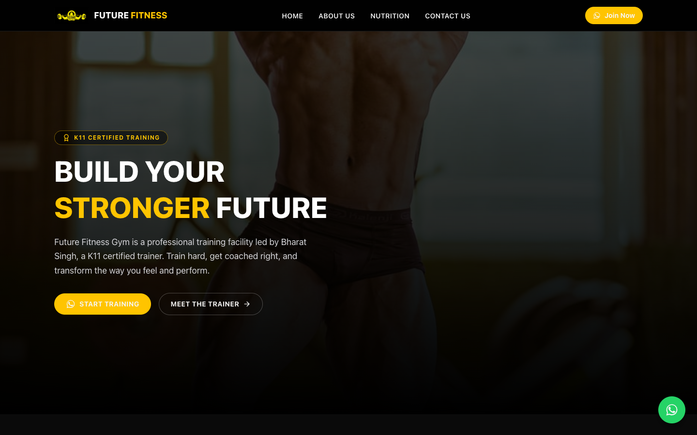

<div align="center">

# Future Fitness Gym

### A fast, conversion-focused website for a modern fitness brand

[](https://nextjs.org/)
[](https://react.dev/)
[](https://tailwindcss.com/)
[](https://futurefitnessgym-beta.vercel.app/)

[Live Website](https://futurefitnessgym-beta.vercel.app/) · [Report an Issue](https://github.com/adityajaiswal1724/static-gym-website/issues)

</div>



## Overview

Future Fitness Gym is a responsive, multi-page marketing website built for a real-world local fitness business. It combines bold visual direction with clear calls to action, trainer credibility, practical nutrition resources, and direct WhatsApp conversion flows.

The application is statically exported, requires no runtime server, and is deployed globally through Vercel.

## Product highlights

- High-impact landing page with an image-led hero and direct training CTA
- Trainer profile and credibility-focused About experience
- Goal-based nutrition plans with pre-filled WhatsApp enquiries
- Contact page with business hours, directions, phone, and social links
- Persistent mobile-friendly WhatsApp action
- Responsive navigation, reusable content sections, and accessible focus states
- Search-friendly metadata and a branded favicon
- Fully static output for fast, low-maintenance hosting

## Tech stack

| Layer | Technology |
| --- | --- |
| Framework | Next.js 16 App Router |
| UI | React 19, Tailwind CSS 4 |
| Language | JavaScript / JSX |
| Architecture | Static export, reusable server-rendered components |
| Deployment | Vercel |

## Application structure

```text
app/
├── page.jsx              # Conversion-focused landing page
├── about/page.jsx        # Trainer story, credentials, gallery
├── nutrition/page.jsx    # Goal-based diet-plan catalogue
├── contact/page.jsx      # Contact methods, hours, location
└── globals.css           # Brand system and responsive styling
components/               # Navigation, footer, CTA and UI primitives
lib/site.js               # Centralised business and contact content
public/images/            # Optimised local brand photography
```

Centralising business information in `lib/site.js` keeps the phone number, social links, brand identity, and trainer details consistent across every page.

## Run locally

```bash
git clone https://github.com/adityajaiswal1724/static-gym-website.git
cd static-gym-website
npm ci
npm run dev
```

Open [http://localhost:3000](http://localhost:3000).

## Production build

```bash
npm run build
```

`next.config.mjs` enables a static export, so the production site can be served from any static host. No environment variables, database, CMS, or API keys are required.

## Design decisions

- **Conversion first:** primary actions open WhatsApp with minimal friction.
- **Local assets:** photography and branding are served from the repository for predictable loading.
- **Content reuse:** shared site data prevents duplicated contact details.
- **Progressive responsiveness:** layouts scale from compact mobile screens to wide desktop viewports.
- **Low operational overhead:** static delivery removes server maintenance from the deployment path.

## Roadmap

- Add automated accessibility and end-to-end checks
- Add structured local-business data and richer social previews
- Add a lightweight CMS for schedules, plans, and announcements
- Add performance monitoring and conversion analytics with consent controls

---

<div align="center">
Built with Next.js and deployed on Vercel.
</div>
